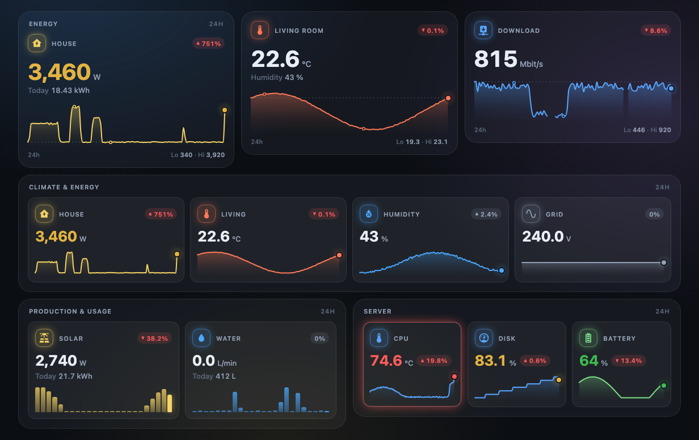

# Glasshouse Stat Card

Data-rich metric tiles with live sparklines for Home Assistant, part of the **Glasshouse** card suite
(refined dark glass, one accent per device type, the numbers that matter shown large).



## Features

- One big metric, or a balanced grid of several, in one card.
- Smooth area sparkline (monotone curve, accent gradient, last-point glow) or bar chart per stat.
- Trend pill against the start of the window (▲ / ▼ with % change), colour-aware (`inverse` for things where up is bad).
- Threshold colours for the value (`above` / `below`); a threshold set to `alert` pulses the tile.
- Optional secondary line ("Today 18.4 kWh"), min/max markers and Lo/Hi readout.
- Non-numeric entities (binary sensors, text states) render as a state tile with a 24 h state timeline.
- Mouse hover on a chart shows the value and time at that point.
- History comes from **one batched** `history/history_during_period` websocket call per card, refreshed at most every
  5 minutes; live state changes are appended in between. Charts are time-weighted and downsampled to at most 120 points.
- Unavailable / unknown / missing entities show "—" (dimmed, with a badge) and never break the card; gaps in history
  break the line.
- Sections view ready (`getGridOptions`), phone width (360 px) to 4-column desktop, `prefers-reduced-motion` respected.
- No dependencies, no build step: a single JavaScript file.

## Install

### HACS (custom repository)

1. HACS → three-dot menu → **Custom repositories**.
2. Add this repository's URL, category **Dashboard**.
3. Install **Glasshouse Stat Card**, then reload the browser.

HACS adds the resource for you. Without HACS: copy `glasshouse-stat-card.js` to `config/www/`, then add
`/local/glasshouse-stat-card.js` as a **JavaScript module** under Settings → Dashboards → Resources.

## Configuration

```yaml
type: custom:glasshouse-stat-card
title: Energy
hours: 24
stats:
  - entity: sensor.house_power
    name: House
    icon: mdi:home-lightning-bolt
    accent: energy
    decimals: 0
    trend: inverse
    thresholds:
      - above: 3000
        color: warn
      - above: 6000
        color: alert
    secondary: sensor.energy_today
    secondary_label: Today
```

### Card options

| Option | Type | Default | Description |
| --- | --- | --- | --- |
| `stats` | list | **required** | The metrics to show (see below). A plain entity id string is also accepted per item. |
| `title` | string | none | Small label above the tiles, with the window length on the right. |
| `hours` | number | `24` | History window for sparklines, trend and Lo/Hi (max 744). |
| `columns` | number | auto | Grid columns for multiple stats. Auto picks a balanced layout for the card width; a set value is reduced only when tiles would be narrower than `min_tile_width`. |
| `compact` | boolean | `false` | Denser tiles: smaller icon and value, a thin history bar without the "3d ago / now" labels (hover the bar for the window). Good for a wall of status tiles. |
| `min_tile_width` | number | `120` | Narrowest tile (px, 60-400) before a set `columns` is reduced. Lower it to keep short rows, such as four ink levels, on one line on phones. |
| `graph`, `trend`, `extrema`, `accent`, `decimals`, `since`, `name_position`, `tap_action`, `hold_action` | | | Card-level defaults applied to every stat that doesn't set its own. |

A single stat can also be written without the list: `entity:` plus any stat option at the top level.

### Stat options

| Option | Type | Default | Description |
| --- | --- | --- | --- |
| `entity` | entity id | **required** | The entity to show. |
| `name` | string | friendly name | Label above the value. |
| `icon` | string | entity icon | Any `mdi:` icon. |
| `accent` | token or CSS colour | `info` | `energy`, `heat`, `cool`, `water`, `light`, `fan`, `cover`, `switch`, `media`, `lock`, `security`, `neutral`, `ok`, `warn`, `alert`, `info`, or any CSS colour (`#ff9f43`, `rgb(...)`, `var(--my-colour)`). |
| `decimals` | 0–6 | auto | Auto uses the entity's display precision, else the precision of the state itself. |
| `unit` | string | entity unit | Overrides the unit. |
| `graph` | `line` / `bar` / `none` | `line` | Chart type. |
| `bars` | number | hours (12–48) | Bar count for `graph: bar`. |
| `graph_min` / `graph_max` | number | auto | Fix the chart's y-axis range (e.g. `0` / `100` for percentages). |
| `extrema` | boolean | `true` for a single line chart, else `false` | Min/max markers and the Lo/Hi readout. |
| `name_position` | `top` / `below` | `top` | For state tiles: `below` puts the state beside the icon and the full name (same size, up to two lines) under it, so long names aren't cut off. |
| `since` | `below` / `inline` | `below` | For state tiles, where the "for 9h 51m" duration goes: on its own line, or after the state on the value line. |
| `trend` | `normal` / `inverse` / `neutral` / `none` | `normal` | Trend pill colouring: `normal` = up green, `inverse` = up red, `neutral` = grey, `none` hides it. |
| `thresholds` | list | none | Colour the value. Each item: `above` and/or `below` (numbers) and `color` (token or CSS colour). Items are sorted by `above`; the highest matching one wins. `color: alert` also pulses the tile. |
| `secondary` | entity id | none | Small line under the value. |
| `secondary_label` | string | none | Label before the secondary value, e.g. `Today`. |
| `tap_action` | `more-info` / `navigate` / `none` | `more-info` | String or `{action: navigate, navigation_path: /lovelace/energy}`. |
| `hold_action` | same | `more-info` | 500 ms hold. |
| `navigation_path` | string | none | Path for `navigate` when the action is given as a string. |

Non-numeric entities (no unit, state not a number) are shown as a state tile: the formatted state, "for 1h 24m"
since the last change, and a state timeline over the window (`graph: none` hides the timeline).

## Examples

**Four-up climate and energy strip**

```yaml
type: custom:glasshouse-stat-card
title: Climate & energy
stats:
  - entity: sensor.house_power
    name: House
    accent: energy
    trend: inverse
  - entity: sensor.living_room_temperature
    name: Living
    accent: heat
  - entity: sensor.living_room_humidity
    name: Humidity
    accent: water
    trend: neutral
  - entity: sensor.grid_voltage
    name: Grid
    accent: neutral
```

**Bars for production and usage**

```yaml
type: custom:glasshouse-stat-card
title: Production & usage
graph: bar
stats:
  - entity: sensor.solar_power
    accent: energy
    secondary: sensor.solar_energy_today
    secondary_label: Today
  - entity: sensor.water_flow
    accent: water
    trend: neutral
```

**Server health with threshold colours**

```yaml
type: custom:glasshouse-stat-card
title: Server
trend: inverse
stats:
  - entity: sensor.server_cpu_temperature
    name: CPU
    accent: cool
    thresholds:
      - above: 65
        color: warn
      - above: 80
        color: alert
  - entity: sensor.nas_disk_used
    name: Disk
    graph_min: 0
    graph_max: 100
    thresholds:
      - above: 80
        color: warn
  - entity: sensor.home_battery
    name: Battery
    accent: switch
    trend: normal
    thresholds:
      - below: 20
        color: alert
      - above: 50
        color: ok
```

**A week of outdoor temperature**

```yaml
type: custom:glasshouse-stat-card
hours: 168
stats:
  - entity: sensor.outdoor_temperature
    accent: cool
```

## Theming

Every Glasshouse token can be overridden from a theme with the same-named `--glasshouse-*` variable,
for example `glasshouse-surface`, `glasshouse-radius`, `glasshouse-text-2`, `glasshouse-energy`.

## Development

`test/harness.html` renders the card offline with stubbed HA elements and a mock `hass` (synthetic history,
including spikes, a sine, a flat series and unavailable gaps). Open it in a browser, or use `test/shoot.sh` for
headless screenshots (`?w=390` for phone width, `?preview=1` for the README image). `test/gen-mdi.js` builds an
optional icon subset from `@mdi/js` installed in a scratch directory.

## Licence

MIT © Peter Gray
